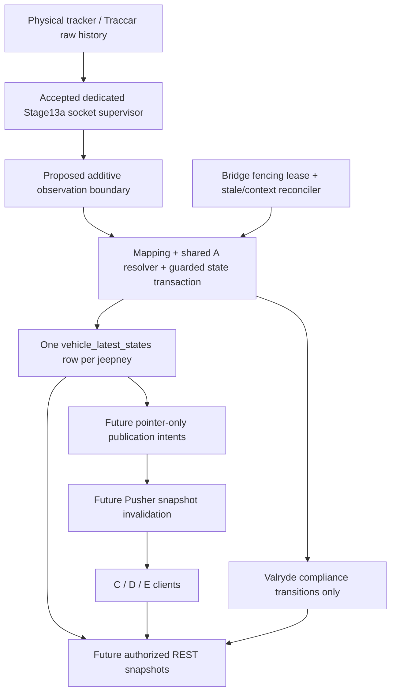

# Stage 13b durable tracking — design for review

Checkpoint: **AGENT_B_STAGE13B_DESIGN_DECISIONS_RESOLVED_FOR_REVIEW**. Architecture direction accepted in principle; exact decisions remain recommended for review. Agent B, IDs12–21. Design release2026-10-22; **PROPOSED, not implementation/migration/client-contract authorization**. Overall B remains IN_PROGRESS.

## Baseline and evidence

Design branch `docs/13b-durable-tracking-design` starts from canonical main **827738c0f2c33ad3082f6a4a38a8e35669d4b0ea**, including accepted Bridge PR10 merge **69deb572a9e323ce5cb2f0fb0f163dafe8df2bbd**, Agent A fixes/contract documentation and unified email PR11. PR10 runtime source previously validated at f8722b1; its final evidence head9d009d5 is merged. Earlier proposals remain history, not approved schemas. Review package: [PR #14](https://github.com/erwin-io/valryde-api/pull/14), [Issue #13](https://github.com/erwin-io/valryde-api/issues/13). Initial design source commit: d4884c0fb2be831701d24254cd9f70ed6592c750; subsequent handoff metadata does not authorize implementation. Concurrent A G1 PR #12 is unmerged and not assumed available; re-fetch/reconcile before implementation.

Application metadata inspected in an explicit `BEGIN READ ONLY` transaction, then rolled back: migrations001–005 only, PostGIS3.6.2/citext1.6/pgcrypto1.3; current mapping/device/route columns match source. Neither proposed tracking table exists. No business rows/telemetry queried. No migrations, fixtures or runtime processes run for this design.

Infrastructure status/evidence reviewed read-only: Windows Traccar6.16.0 development target; prior authenticated native socket/keepalive/reconnect/health/cleanup passed; service-only DPAPI delivery and protected ACLs already verified. This session does not decrypt credentials or change infrastructure. Historical Infrastructure status still calling PR10 OPEN is superseded by current GitHub MERGED evidence. Full canonical V1 DOCX/independent checklist remain unavailable; frozen repository handoffs and owner directives are the available requirements.

## Package

| Output | Review document |
|---|---|
| Architecture, frozen decisions, dependencies, approval gates | This index |
| Proposed schema, constraints, migration/rollback plan | [Schema](SCHEMA_AND_MIGRATIONS.md) |
| Transaction/observation interfaces, locking, ordering, compliance | [Persistence](PERSISTENCE_AND_COMPLIANCE.md) |
| Public/private DTOs, REST/Pusher/auth/reconciliation | [Gateway](GATEWAY_CONTRACT_PROPOSAL.md) |
| Concrete concurrency/failure tests, security, retention/rollout | [Verification and rollout](VERIFICATION_AND_ROLLOUT.md) |
| Explicit D01–D12 recommended resolutions/tests/gates | [Decision register](DECISION_REGISTER.md) |
| A-owned transaction/scope/locks/mapping/context coordination | [A interface boundary](AGENT_A_INTERFACE_BOUNDARY.md) |
|42 detailed acceptance specifications, all planned | [Acceptance specifications](ACCEPTANCE_SPECIFICATIONS.md) |
| Five separately authorized implementation phases | [Release plan](IMPLEMENTATION_RELEASE_PLAN.md) |
| Consolidated G decision package, A dependencies, C/D/E contracts (2026-10-23) | [Parallel readiness package](PARALLEL_READINESS_REVIEW_PACKAGE.md) |

## Architecture

Stage13a lifecycle, cookie authentication, keepalive, bounded retry, validation, queue and shutdown stay in their separate Node process. Fastify/serverless owns request-scoped snapshots/auth, never the persistent socket. PostgreSQL/PostGIS owns current state and application compliance events; Traccar alone owns complete raw history/native events. Gateway/Pusher implementation remains a separate explicit release even where this package proposes its contract.

## Frozen invariants

- Shared `TransitService.resolveEffectiveRouteDirection()` only: active direct assignment wins; otherwise0 inherited→null,1→group direction,>1→ROUTE_ASSIGNMENT_CONFLICT. Never fall back from an unusable direct direction to a group route.
- Admin canonical SRID4326 LineString/corridor; default100m, existing configurable range1–5000m. Metre/spheroid distance, longitude before latitude.
- OFF_ROUTE after30s continuously outside **OR**3 consecutive valid outside fixes; re-entry needs2 consecutive valid inside fixes. Invalid/stale/missing/unusable route→UNKNOWN. No noisy single-point deviation. Proposed continuity details are explicit below, not changed thresholds.
- Commuter available only with active/approved mapped jeepney, tracker ONLINE, valid fix age0–30s inclusive, active selected effective direction and ON_ROUTE. STOPPED is eligible; ACC/driver phone GPS not required. ~60s stationary reporting is F/hardware work, not permission to widen30s.
- DRIVER assigned/created-permitted/same-group scope, OPERATOR own fleet, ADMIN platform, COMMUTER public-safe only; use A authorization with existence semantics. No provider identity/credentials in mobile DTOs.

## Required decisions and implementation gates

All recommended choices below are proposals. **No implementation proceeds merely because a design PR merges.** G must explicitly release named components and migrations after design review.

The authoritative [D01–D12 decision register](DECISION_REGISTER.md) supplies explicit recommendations, mapped acceptance cases, approvers and phase gates. Every decision is RECOMMENDED / APPROVAL_PENDING. Earlier architecture/locking findings are preserved; none is approved because its document exists.

[Agent A coordination and proposed interface boundary](AGENT_A_INTERFACE_BOUNDARY.md) records delivery status, current-schema gaps and the explicit ban on speculative adapters. [P1–P5 release plan](IMPLEMENTATION_RELEASE_PLAN.md) separates exact migration PR, latest state, compliance/events, reconciliation/readiness, then gateway. [Given/When/Then specifications](ACCEPTANCE_SPECIFICATIONS.md) finalize the same42 planned IDs.

## C/D/E dependency matrix

| Consumer / checklist | Current accepted inputs | Needs13b | Further gate / owner |
|---|---|---|---|
| C route/live availability29–35 | A active routes/directions/colors/geometry | Public eligible latest-state projection, expiry/removal | D09/D10; approved gateway + compliance, not raw Bridge sink |
| D own GPS/status42–45 | A jeepneys/effective route/scope | Private current state, same-group filtering, UNKNOWN reasons | A executor/scope D05 and gateway release |
| D Operator fleet47/51/53/54 | A owned fleet/groups | Per-snapshot counts, stale/unknown buckets, compliance/events | D05/D08/D09; aggregate semantics no client counting off unscoped data |
| E global map/device65–66 | A ADMIN auth/canonical routes/GPS workflow | Global current state, safe diagnostics, compliance transitions | D01/D05/D09; no Traccar credentials in UI |
| E reports/health67 | A business entities and generic /api/health | Scoped events, retention/provenance, Bridge/DB/publisher health distinctions | Separate report/export and operational contract; native history in Traccar |

The full C/D/E matrices were reviewed as consumer requirements, not approval to modify their repositories. A G1 directory proposal is merged documentation, not assumed implemented runtime endpoints.

## Verification scope and next action

This package has documentation/static consistency verification only plus the read-only metadata inspection. Concurrency/PostGIS/state/gateway tests below are executable acceptance specifications **NOT_RUN** in this design release. Historical13a tests are not13b evidence. Review issue/PR and exact proposal HEAD are supplied in the PR/status/chat; no self-referential hash baked into all documents.

Next: G reviews recommended D01–D12 resolutions and A delivers the shared interface for approval. Then G explicitly releases the named P1–P5 phase, approved A dependency approach, authorized isolated app test DB and exact migration ownership. Continue review on PR14; no schema/runtime work is authorized.
